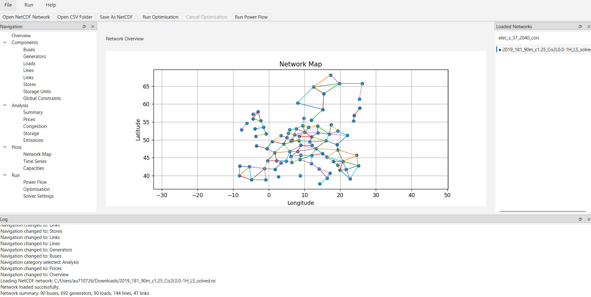
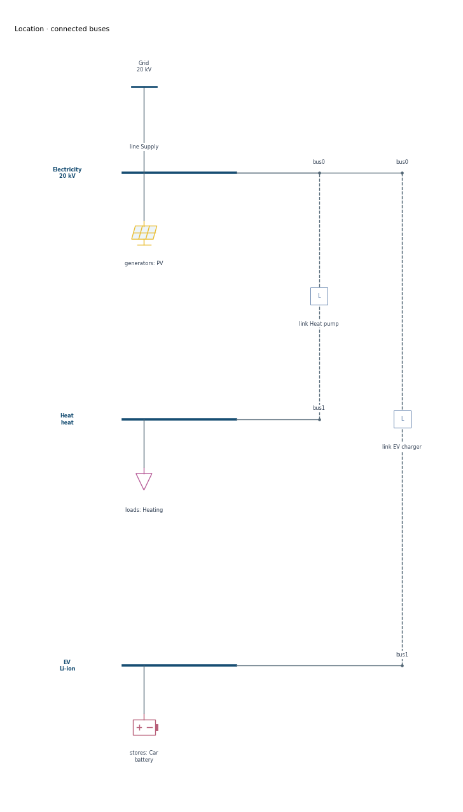

# pypsa-gui

An experimental desktop workbench for building, inspecting, optimising, and visualising PyPSA energy-system models.

The application combines a PySide6 interface with PyPSA, pandas, and Matplotlib. It is intended for teaching, model exploration, and research prototyping: load an existing network, build a small scenario, inspect components and results, and export figures or an analysis report.



**Status:** active prototype, package version `0.1.0`. The application now contains substantial modelling and analysis functionality, but some workflows are incomplete and numerical validation needs broader test coverage. See [Known limitations](#known-limitations) before using results in a study.

**Solvers:** HiGHS is included and selected by default. Gurobi is also supported when installed and licensed. Apply your choice in **Run → Solver Settings**; model previews and optimisation runs use the applied settings for the active network.

## What is implemented

| Area | Current capabilities |
| --- | --- |
| Network files and sessions | Open NetCDF networks or PyPSA CSV folders; keep several networks in memory; switch the active network; save or save as NetCDF. |
| Scenario Builder | Create a country subset of the bundled teaching network, configure demand, technologies, investment costs, interconnection, and CO₂ policy. |
| Network Builder | Create an empty network, place locations on a map, add internal buses and assets, and connect locations with lines or links. |
| Component inspection | Inspect and edit static component tables; search, sort, show or hide columns, and copy selected cells in the general component pages. |
| Bus and location diagrams | Explore connected equipment, navigate to neighbouring buses, inspect parameters, group buses visually, and export diagrams. |
| Analysis | Network summary, nodal prices, line/link loading, storage operation, and generator-emissions views. |
| Plots | Geographical or schematic network maps, installed-generation capacity mixes, time-series selection and aggregation, and capacity/generation views. |
| Optimisation | Background execution, cancellation requests, a model-size preview, and PDF analysis reports for networks containing results. |
| Pre-run tools | Add load-shedding generators, constrain per-asset or total investment capacity, and average consecutive snapshot blocks with preserved weights. Changes are validated together and clear previous results. |
| Workflow records | Display recorded operations, canonical and semantic identifiers, and export a workflow record as JSON. |
| Research modules | A module registration interface, a flow-tracing input preview, and an ML-surrogate configuration interface. The scientific backends are not complete. |

## Installation

Python **3.10 or newer** is declared in `pyproject.toml`. The supplied Conda environment selects Python **3.11**. Run installation commands from the directory containing `pyproject.toml`.

Clone the repository:

```bash
git clone https://github.com/alexfias/pypsa-gui.git
cd pypsa-gui
```

Alternatively, download and extract the repository ZIP, then open a terminal in its extracted project directory.

### Conda / Miniconda

```bash
conda env create -f environment.yml
conda activate pypsa-gui
pypsa-gui
```

The environment file already installs the project in editable mode. If you already have a suitable environment, activate it and run:

```bash
python -m pip install -e .
pypsa-gui
```

### Standard Python virtual environment

Create the environment:

```bash
python -m venv .venv
```

Activate it with the command for your shell:

| Shell | Command |
| --- | --- |
| Windows Command Prompt | `.venv\Scripts\activate.bat` |
| Windows PowerShell | `.venv\Scripts\Activate.ps1` |
| Linux / macOS | `source .venv/bin/activate` |

Then install and launch:

```bash
python -m pip install -e .
pypsa-gui
```

The equivalent module entry point is:

```bash
python -m pypsa_gui.main
```

### Solving networks

HiGHS is installed with the application and works without a separate commercial solver licence. To use Gurobi instead, install its Python interface in the same environment:

```bash
python -m pip install gurobipy
```

Configure a Gurobi licence suitable for your model size; see the [official installation guide](https://support.gurobi.com/hc/en-us/articles/360044290292-How-do-I-install-Gurobi-for-Python).

Open **Run → Solver Settings**, choose `highs` or `gurobi`, adjust the options, and click **Apply**. Then open **Run → Optimisation** or use the optimisation toolbar action. The applied solver is displayed above the run controls.

- Applied settings are retained separately for each open network, including when switching workspaces. They are kept in memory, not saved in the network's NetCDF file. Applying settings before loading a network changes the defaults for new sessions.
- Transmission losses and linearised unit commitment are passed to model construction for both preview and solve. Dual assignment is passed to the solve step.
- Method, crossover, presolve, threads, time limit, relative MIP gap, and primal/dual tolerances are translated to the selected solver's native options. Auto/None/Default omits an option; a MIP gap of zero is supported explicitly.
- Method codes are explained in the control's tooltip. HiGHS supports Auto, primal simplex, dual simplex, and interior point here; Gurobi also offers concurrent methods. Use Auto for mixed-integer or quadratic HiGHS models: forcing an LP algorithm is rejected to prevent dropping integer or quadratic terms.
- Extra options must be a JSON object of native solver options; these override matching fields above. For example, use `{"ipm_optimality_tolerance": 1e-8}` for HiGHS or `{"BarConvTol": 1e-8}` for Gurobi. Unknown or invalid HiGHS options are rejected before building the model.
- A running optimisation uses a copy of the applied settings. The settings page is disabled during the run, and the log and workflow JSON record the solver, effective options, model flags, and dual-assignment choice.

Unavailable solvers produce an explicit error; the application does not silently switch solvers. Gurobi checks its licence when starting a solve. See the native [HiGHS options](https://ergo-code.github.io/HiGHS/dev/options/definitions/) and [Gurobi parameters](https://docs.gurobi.com/projects/optimizer/en/current/reference/parameters.html) for advanced settings.

### Optional dependencies

```bash
python -m pip install -e ".[map]"
python -m pip install -e ".[dev]"
```

The `map` extra installs Cartopy; the `dev` extra installs pytest, Black, and Ruff. Geographical plotting works without Cartopy. The **Network Map** renderer uses locally cached Cartopy coastline and border data when available, and otherwise displays the network on longitude/latitude axes.

The base installation includes PyPSA, HiGHS, pandas, PySide6, Matplotlib, NetworkX, and ReportLab. Dependency versions are not currently locked.

## First walkthrough

1. Start `pypsa-gui`.
2. Use **File → Open NetCDF Network...** or **File → Open CSV Folder...**. For an included example, open `src/pypsa_gui/data/teaching/elec_s_37.nc` from the repository.
3. Choose **Full** to expose all sections. The **Loaded Networks** dock selects the active network.
4. Explore **Overview**, the component tables, and **Components → Buses**. Use the bus diagram to inspect equipment and neighbouring buses.
5. Open **Plots → Network Map**. Try Auto, Geographical, and Schematic layouts, and switch between topology and installed generation capacity.
6. Optionally configure **Run → Solver Settings** and click **Apply**. Open **Run → Optimisation**, preview the model size if useful, and run the model. HiGHS works with the default installation. Check the returned solver status before interpreting results.
7. Explore **Analysis** and **Plots**. Networks that already contain results can be inspected without rerunning optimisation. The Optimisation page also offers PDF report export.
8. Save the network through **File → Save As NetCDF...**. Export the workflow JSON separately from **Overview → Workflow** if needed.

Workspace presets control navigation: **Full** exposes all sections; **Lightweight** exposes Build, Components, and Run; **Analysis** exposes Overview, Analysis, and Plots. A Custom option selects individual sections.

## Building models

### Teaching scenarios

Open **Build → Scenario Builder** and select **one to three countries**. The current interface offers Germany, Denmark, the Netherlands, Belgium, France, Spain, Poland, and Norway, using the bundled `elec_s_37.nc` source network.

Available presets are **Reference**, **Cheap batteries**, **High CO₂ price**, **High demand**, and **No interconnection**. Further controls set demand scaling, technology inclusion, investment-cost multipliers, interconnection, and a CO₂ price or emissions cap. The builder adds standard battery and hydrogen-storage investment options and creates an unsolved network in a new session.

Country selection removes components outside the selected countries and connections to them; it does not model exchanges with the omitted system. The relative CO₂ target uses a demand-based reference of **0.35 tCO₂/MWh**, rather than historical emissions or a solved reference scenario. Presets and subsequent custom settings can combine, so inspect the scenario assumptions before comparing results.

### Networks from scratch

Open **Build → Network Builder → Create empty network**. Place locations, open a location to add internal buses, then add generators, loads, stores, or storage units. Use the line and link tools to connect locations.

Generator dialogs include technology presets and renewable-availability profiles. The bundled profile library contains example solar and onshore-wind profiles for Germany and Spain; profiles from a loaded network can also be registered. Technology costs are explicitly illustrative defaults, not a maintained cost database.

The separate **Start from template** option is currently disabled.

## Visualisation and reporting

- **Network Map:** deterministic schematic fallback for missing or unsuitable coordinates; lines, links, transformers, and isolated buses; carrier colours and generation-capacity pies. The installed-capacity view uses `generators.p_nom`, not `p_nom_opt`.
- **Bus diagrams:** all directly connected equipment, technology or electrical symbol modes, component details, neighbouring-bus navigation, scrollable canvases, and a separate-window explorer.
- **Location diagrams:** group buses by a matching, non-empty `buses.location` value, or select a manual group. Each bus retains its own busbar and equipment. Grouping is a visual operation and does not aggregate the network equations.
- **Time series:** select component types, fields, carriers, and assets; display individual series or aggregate them by sum, mean, or carrier.
- **Exports:** the shared figure panel exports PNG, SVG, and PDF. The optimisation report includes scenario assumptions, objective value, demand and generation, electricity-price statistics, capacities, storage, and generator emissions where data are available.

See the [network-map guide](docs/visualization-step-1.md) and [bus/location-diagram guide](docs/bus-diagrams.md) for detailed controls and rendering scope. Older implementation notes in those guides describe earlier snapshots of the project.



## Scientific calculations and pre-run tools

The Emissions page and PDF report use the same generator calculation:

```text
tCO2 per snapshot = generator dispatch / efficiency
                   × carrier co2_emissions × snapshot_weightings.generators
```

Carrier factors are in **tCO2/MWh of primary energy**. Static and time-varying generator efficiencies are supported; emitting assets need finite positive efficiency. Signed dispatch and negative emission factors are retained, matching the generator contribution to PyPSA's primary-energy accounting. This does not include all terms of a sector-coupled CO2 constraint. Generation totals, intensity denominators and zero-emission shares use weighted positive generation. Totals describe the represented modelled period, not an assumed full year; economic investment-period discount weights are not physical energy weights.

Demand calculations combine static loads with their time-series overrides. Electricity-price averages in the GUI and PDF use electricity demand and represented hours; auxiliary hydrogen/heat buses are excluded from that average. Bus price means, negative-price bus-hours, price-duration curves and congestion hours also use represented hours. Storage discharged energy and mean state of charge use `snapshot_weightings.stores`, matching storage-transition durations. The storage efficiency card shows the mean product of charging and discharging efficiencies. Scenario CO2 prices also correct time-varying marginal costs using time-varying efficiencies.

In **Pre-Run Tools → Capacity Constraints**:

- **Total capacity of all matches** adds a true `=`, `>=` or `<=` constraint on the sum of capacity. Fixed assets contribute their existing capacity; the optimiser chooses the distribution across extendable assets.
- **Limit each matching asset individually** tightens `p_nom_min`/`p_nom_max` or `e_nom_min`/`e_nom_max`. Equality sets both bounds. Fixed assets remain fixed and must already satisfy the requested limit; conflicts are reported before changes are applied.
- Generator, Link and StorageUnit limits are in **MW**; Store limits are in **MWh**. Investment extendability is never enabled implicitly.
- Total limits retain the selected asset names and survive NetCDF saving. Deleted/renamed assets cause a validation error rather than silently changing the selection. Reapplying the same selection and sense replaces its limit. **Preview Changes** lists applied totals; **Clear GUI Total Capacity Limits** removes them. Per-asset bounds remain editable in component tables.

For an exported network containing GUI total limits, solve through the application service:

```python
from pypsa_gui.services.optimisation import run_network_optimisation

status, condition = run_network_optimisation(network)
```

**Temporal Downsampling** now averages consecutive blocks of `n` snapshots. Every weighting column is summed, including the final partial block. Input profiles use generator weights, storage inputs use store weights, and costs use objective weights. Generator efficiency is aggregated through its reciprocal (fuel per unit of output). Static inputs stay static; solved outputs are cleared. This preserves weighted demand, availability and inflow integrals, but does not guarantee an identical optimum, peak capacity, fuel consumption, or storage trajectory after reduction.

Pre-run options are checked on a candidate network and applied together. A validation failure leaves the live network unchanged. Successful changes mark the session modified, refresh dependent pages, and clear previous results; rerun optimisation before analysing or exporting results. Pre-run tools are disabled during a solve. Load-shedding capacity based on peak load includes both static and dynamic demand.

## Known limitations

The following distinctions matter when using the current version:

| Area | Limitation |
| --- | --- |
| Solver lifecycle | Applied settings persist for the open session, not across application restarts. Cancellation is best effort and depends on the running solver model exposing a termination method; it may be unavailable during model construction or in some solver/library versions. |
| Power flow | The navigation page is a placeholder, and the menu action does not execute a power flow. |
| Component editing | Renaming a component in a general component table changes its static index without renaming its time-series columns. Avoid this operation for assets with time series. Validation and refresh after edits are incomplete. |
| Saving changes | Pre-run changes mark the session modified; general table-edit tracking remains incomplete. Closing the application does not prompt to save modified networks. Save explicitly; the session list and workspace state are not a persistent project format. |
| Temporal reduction | Weighted block averaging preserves represented duration and weighted input profiles, but smooths peaks and changes correlations/storage behaviour. Unit commitment, maintenance, ramp limits, fixed storage-state targets, transport delays, multi-period and stochastic networks are rejected by this tool. |
| Capacity controls | Per-asset limits tighten investment bounds. Total limits are saved in network metadata and added by the GUI optimisation service, including previews. Plain external `network.optimize()` does not install these custom limits; use `run_network_optimisation` or add them explicitly. Total limits currently support single-period, deterministic networks. |
| Emissions scope | GUI and PDF share weighted, efficiency-corrected generator emissions. This is not a complete sector-coupled carbon account: non-cyclic storage inventory changes and separate Link/Process emissions are excluded. Missing carrier factors count as zero; invalid emitting-generator efficiencies are rejected. |
| Result validity | Pre-run changes clear old results and the model. Other input-edit paths do not yet systematically invalidate results. PDF availability is inferred from generator-dispatch data, not from a fresh successful solve. Rerun after input changes and inspect solver termination status. |
| Workflow records | Selected creation, loading, and optimisation operations are recorded. Not every edit is captured; workflow JSON is exported separately and is not a complete replayable project archive. |
| Research modules | Flow Tracing currently previews input arrays for link-based networks; it does not calculate flow attribution. ML Surrogate can save/load configuration, but dataset processing, training, and evaluation are placeholders. |

The map displays multi-terminal links between `bus0` and `bus1`; local bus/location diagrams provide more terminal detail. Symbols are simplified, not an IEC-certified symbol set. Pandapower import and automated scenario comparison are not implemented.

The bundled teaching network was exported by an older PyPSA version and may produce compatibility warnings. Check model assumptions, component data, snapshot weights, and solver results when using it with another PyPSA version. For emissions accounting, compare against [PyPSA's documented formulation](https://docs.pypsa.org/latest/user-guide/optimization/global-constraints/#primary-energy).

## Code structure

| Directory | Responsibility |
| --- | --- |
| `src/pypsa_gui/models/` | Network sessions, view options, locations, scenario definitions, solver settings, and profile/preset models. |
| `src/pypsa_gui/services/` | Network IO and storage, scenario construction, time-series/technology libraries, optimisation, analysis, and PDF reporting. |
| `src/pypsa_gui/ui/` | Main window, navigation, dialogs, tables, pages, and reusable figure widgets. |
| `src/pypsa_gui/visualization/` | Network, bus, and location renderers and technology symbols. |
| `src/pypsa_gui/workers/` | Background optimisation worker. |
| `src/pypsa_gui/workflows/` | Workflow operations, recording, JSON serialisation, and identifiers. |
| `src/pypsa_gui/modules/` | Research-module interface, registry, and initial modules. |
| `src/pypsa_gui/data/` | Bundled teaching network, technology presets, and example time-series profiles. |
| `tests/` | Renderer, diagram, export, Qt-interaction, solver-configuration, and HiGHS integration checks. |

The intended design separates UI, session state, numerical services, and plotting. Some builders and reports remain large and would benefit from further separation. Expensive analysis-page data refreshes are deferred until those pages are opened; model previews and report generation still run on the UI thread.

To add a research module, implement `BaseResearchModule` from [modules/base.py](src/pypsa_gui/modules/base.py), describe its pages with `ModulePageDefinition`, and register it in [modules/registry.py](src/pypsa_gui/modules/registry.py). The current registry is explicit; dropping a file into the directory does not register it automatically.

## Development and validation

```bash
python -m pip install -e ".[dev]"
python -m pytest -q
```

For a headless Linux run:

```bash
QT_QPA_PLATFORM=offscreen MPLBACKEND=Agg python -m pytest -q
```

The suite contains **90 test cases**: 33 visualisation checks, 22 solver-configuration checks and 35 scientific-consistency checks. Solver tests include real HiGHS LP/MIP solves, native options, changing thread counts, menu/button execution, applied settings across session/page changes, workflow recording, and invalid-configuration handling. Gurobi argument forwarding is tested with a test double; a licensed Gurobi solve has not been exercised in this review.

Scientific checks cover analytic weighted-emissions examples, agreement with a binding PyPSA CO2 constraint, dynamic CO2 pricing, static/dynamic load combinations, weighted prices/storage/congestion, real HiGHS capacity investments, NetCDF constraint persistence, aggregation conservation, invalid-input rejection, atomic GUI changes and PDF generation. NetCDF tests disable PyPSA's optional online version check.

The suite was run with Python 3.12, PyPSA 1.4.0, HiGHS 1.15.1, PySide6 6.12.0, and pandas 3.0.6. This is evidence for the covered behaviour, not full application or cross-platform validation. The repository does not yet include a CI workflow or broad regression coverage for all scenario construction and editing paths.

Priorities for the next development stage:

1. Centralise validated network edits, safe renaming, result invalidation, and save-state tracking.
2. Extend carbon accounting to sector-coupled networks and validate temporal-reduction accuracy on larger, representative models.
3. Add regression tests for those workflows and run them in CI with a documented dependency set; broaden solver and platform coverage.
4. Implement power flow and complete research-module backends as separate, tested additions.

Contributions and issue reports are welcome. Include the relevant steps, a minimal network when possible, dependency versions, and the solver status or traceback.

## Licence

The application code is licensed under the [MIT License](LICENSE). Third-party dependencies and solvers retain their own licences.
